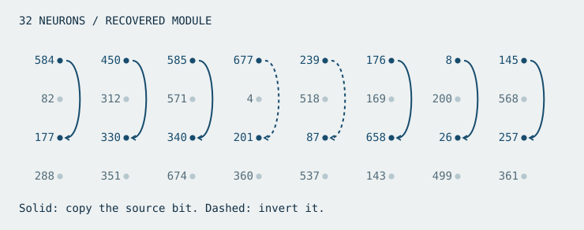

# Scientific Worlds

**How does an AI scientist decide what to study?** An agent gets 720 anonymous binary inputs, 20 auxiliary controls and 20 readouts. Every measurement spends capital it will need to build eight devices. A device must hold its target across 100,000 environmental inputs. The agent chooses its own experiments, representations and circuits.

[Read the illustrated article](https://dracoxu.com/writing/scientific-worlds/) · [Run your model](docs/run.md) · [Scoring and evidence](docs/method.md)



## Astra 6.0 Max

| Model and session budget | **M · microscopic law** | N0 · operating rules | F · structural family |
|---|---:|---:|---:|
| Astra 6.0 Max · 10–12 active hours | **8% (2/25)** | 0% (0/11) | 100% (11/11) |

The unit is a scored session. The row pools development, registered evaluation and same-world replication. Both M successes occurred on the same physical world. One used material wording and the other neural wording. Three early M and three early N0 sessions had a code-extraction defect. [Full counts and historical protocol](docs/method.md) · [47 session records](evidence/sessions.json) · [Scorecard JSON](evidence/scorecard.json).

## Start here

Python 3.11+ and its standard library are sufficient for all three free checks.

```sh
git clone https://github.com/BeibaiDraco/scientific-worlds-benchmark.git
cd scientific-worlds-benchmark
git checkout v1.0.0
python3 benchmark/runner/cli.py self-test
python3 evidence/report.py --check
python3 evidence/replay.py
```

The first command after checkout checks the frozen engine, all nine prompt templates and the reference devices on three public worlds. The second recalculates delivery from the session records. The third replays the historical winning design on a relabelled teaching specimen with new public deployment streams. Expected result: eight working devices, eight verified wiring relations per device, two capital remaining at startup. All three use zero model calls.

## Run an independent evaluation

On an unprivileged Linux host, install the worker dependencies and follow the short [Linux quickstart](docs/run.md). The included adapter talks to local or hosted chat-completions servers. Choose a condition, family and budget, and retain the run directory to replay the result. The participant gets its condition prompt, public worker files and paid observations. The judge, receipt log and model credentials live on the operator side.

```sh
/tmp/sw-python/bin/python host/run.py run runs/my-session \
  --family B --condition M --model qwen2.5-coder:1.5b \
  --base-url http://localhost:11434/v1 --seed 101 --turns 2 --seconds 600 --reply-tokens 512
/tmp/sw-python/bin/python host/run.py replay runs/my-session
```

This is a short public development session. For blind comparisons, precommit the same fresh tasks, prompts and budgets for each model. [How to report or submit a result](docs/method.md#comparing-a-new-model) · [Linux test workflow](.github/workflows/linux.yml) · [Citation](CITATION.cff) · [MIT license](LICENSE).
